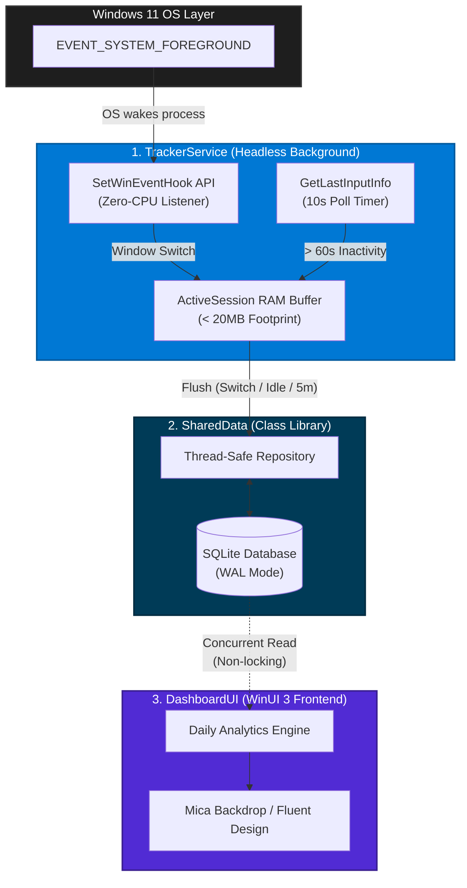

<div align="center">

# ⏱️ ScreenPi

**The zero-footprint, native Screen Time engine for Windows.**

[](https://dotnet.microsoft.com/)
[](https://learn.microsoft.com/en-us/windows/apps/winui/winui3/)
[](https://sqlite.org/)
[](#)
[](#)
[](https://opensource.org/licenses/MIT)

*ScreenPi brings the seamless, premium experience of macOS and iOS Screen Time to Windows 11. Built the way desktop applications were always meant to be built: zero Electron bloat, no constant polling loops, and strict data privacy. Just raw, unmanaged system-level performance paired with a breathtaking Fluent UI.*

[**Explore Architecture**](#-the-architecture) · [**Read the Docs**](#) · [**Report Bug**](#)

<br/>

</div>

---

## 📜 The ScreenPi Manifesto

Most modern desktop trackers are web applications disguised as native apps. They consume hundreds of megabytes of RAM just to run a background timer, relying on brute-force `while(true)` loops that prevent your CPU from entering low-power states. 

**ScreenPi is an engineering love letter to the Windows API.** 

By physically decoupling the background telemetry engine from the presentation layer, ScreenPi achieves a microscopic resource footprint. The UI only exists in memory when you explicitly summon it. The background tracker sleeps perfectly until the OS wakes it.

---

## 🏛️ The Architecture

The solution is divided into three highly specialized, decoupled projects to guarantee absolute zero-CPU background monitoring and non-blocking data reads.



---

## ⚙️ Engineering Masterclass: Solving the Bottlenecks

ScreenPi isn't just an app; it's a blueprint for doing Windows development *right*. Here is how we solved the most common desktop development anti-patterns:

| Constraint Solved | Implementation | The Engineering Benefit |
| :--- | :--- | :--- |
| **Zero-CPU Tracking** | Win32 `SetWinEventHook` + `GetMessageW` | Abandons `Thread.Sleep` polling entirely. The app consumes **0.0% CPU** because it literally blocks and waits for the OS event loop to wake it. |
| **GC Crash Immunity** | `static NativeMethods.WinEventDelegate` | Prevents the .NET (CLR) Garbage Collector from randomly reclaiming unmanaged P/Invoke callbacks, eliminating `AccessViolationException` crashes. |
| **Micro Disk I/O** | `ActiveSession` RAM buffering | Disk thrashing kills SSD lifespans. ScreenPi holds live seconds in RAM, flushing to disk *only* upon context switch, a 60-second idle trigger, or every 5 minutes. |
| **Concurrent DB Access**| SQLite `PRAGMA journal_mode=WAL` | Write-Ahead Logging allows the background service to save data at the exact same millisecond the dashboard is reading it, preventing fatal `database is locked` errors. |
| **Native Typography** | WinUI 3 + `MicaBackdrop` | Renders with hardware acceleration, native font smoothing, and fluid acrylic materials—achieving an Apple-level aesthetic without Electron bloat. |

---

## 🚀 Getting Started

### Prerequisites
*   Windows 10 (Build 17763+) or **Windows 11** (Recommended for Mica material)
*   [.NET 8.0 SDK](https://dotnet.microsoft.com/download)
*   Visual Studio 2022 (with "Windows application development" workload)

### Installation & Execution

**1. Clone the repository**
```powershell
git clone https://github.com/<YOUR_GITHUB_USERNAME>/ScreenPi.git
cd ScreenPi
```

**2. Build the foundation**
```powershell
dotnet build ScreenPi.sln
```

**3. Start the Engine (Background Monitor)**
Run this to initialize the `TrackerService`. It runs silently in your terminal and creates the local SQLite database at `%LOCALAPPDATA%\ScreenPi\screenpi.db`.
```powershell
dotnet run --project TrackerService\TrackerService.csproj
```

**4. Launch the Dashboard (Frontend)**
Open a *new* terminal window, ensure the platform flag is set to x64, and launch the UI to view your data in real-time.
```powershell
dotnet run --project DashboardUI\DashboardUI.csproj -p:Platform=x64
```

---

## 🧠 Code Highlight: The Zero-CPU Engine

Here is the precise P/Invoke architecture that allows ScreenPi to listen to the OS without polling. This is the heart of the application:

```csharp
// Declared as STATIC to survive the .NET Garbage Collector during unmanaged execution
private static WinEventDelegate _winEventDelegate = new WinEventDelegate(WinEventProc);

// Subscribe directly to the OS shell layer
_winEventHook = SetWinEventHook(
    EVENT_SYSTEM_FOREGROUND, EVENT_SYSTEM_FOREGROUND, 
    IntPtr.Zero, _winEventDelegate, 
    0, 0, WINEVENT_OUTOFCONTEXT
);

// Block the thread efficiently until an OS message arrives
int bRet;
while ((bRet = GetMessage(out MSG msg, IntPtr.Zero, 0, 0)) != 0)
{
    TranslateMessage(ref msg);
    DispatchMessage(ref msg);
}
```

---

## 🗺️ The Roadmap

- [x] **Phase 1:** Zero-CPU Win32 background tracking & SQLite WAL data layer.
- [x] **Phase 2:** WinUI 3 Dashboard (Total Time, App List, Date Picker).
- [ ] **Phase 3:** High-Res Icon Extraction Engine (displaying native `.exe` app logos in the UI).
- [ ] **Phase 4:** Smart Categorization (Auto-grouping into *Games, Productivity, Browsers*).
- [ ] **Phase 5:** System Tray Integration (Run completely invisible on startup).
- [ ] **Phase 6:** Digital Wellbeing Enforcer (On-screen limits and top-most window nudges).

---

## 🤝 Contributing

We welcome contributions from Windows engineers who share a passion for performance and clean UI.

1. Fork the Project
2. Create your Feature Branch (`git checkout -b feature/AmazingFeature`)
3. Commit your Changes (`git commit -m 'Add some AmazingFeature'`)
4. Push to the Branch (`git push origin feature/AmazingFeature`)
5. Open a Pull Request

---

## 🔒 Privacy & License

**ScreenPi is strictly 100% offline.** 
Your screen time data is stored exclusively on your machine at `%LOCALAPPDATA%\ScreenPi\screenpi.db`. No telemetry is sent to the cloud. No analytics are tracked. You own your hardware, and you own your data.

Distributed under the **MIT License**. See `LICENSE` for more information.

<br/>

<div align="center">
  <i>Engineered for Windows. Built with C#.</i>
</div>
