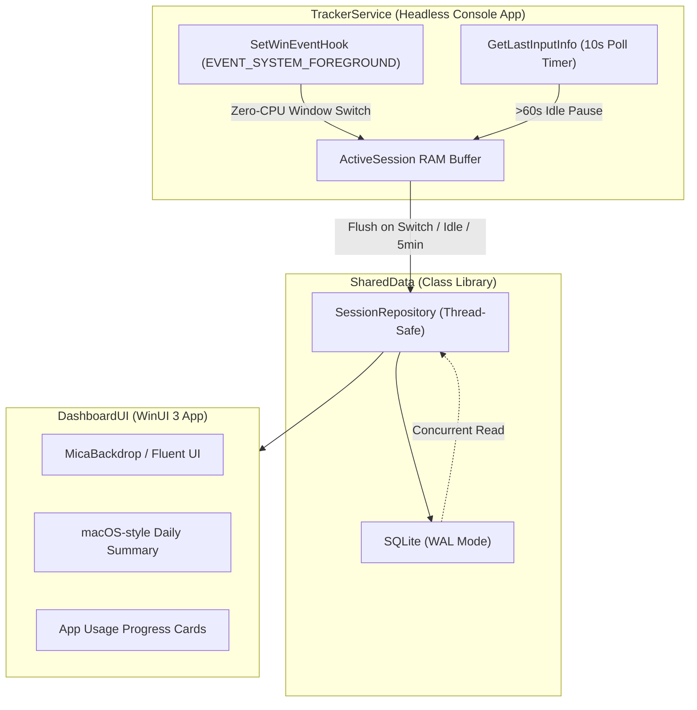

# ScreenPi ⏱️

**ScreenPi** is a high-performance, decoupled native Windows screen time tracker built with **C#** and **.NET 8**. It adheres strictly to zero background CPU overhead, minimal disk I/O, and modern Windows 11 Fluent Design aesthetics.

---

## 🏛️ Architecture

The solution is divided into three decoupled projects:



1. **`SharedData` (Class Library):**
   - SQLite persistence with `Microsoft.Data.Sqlite`.
   - **WAL (`Write-Ahead Logging`) mode** enabled for concurrent reads and writes with minimal disk contention.
   - Thread-safe repository operations (`InsertAndGetId`, `Update`, `GetDailySummary`, `GetTotalScreenTime`).

2. **`TrackerService` (Headless Console App):**
   - **Zero-CPU Tracking:** Uses Win32 `SetWinEventHook` with `EVENT_SYSTEM_FOREGROUND` and a blocking message pump (`GetMessageW`). Zero polling loops.
   - **GC Crash Prevention:** `WinEventDelegate` assigned to a `static` field to prevent unmanaged P/Invoke garbage collection crashes.
   - **Idle Detection:** Polls `GetLastInputInfo()` via a system timer every 10 seconds. Automatically pauses tracking and excludes idle time when inactive for > 60 seconds.
   - **Disk I/O Optimization:** Active session state and durations are buffered purely in RAM. Flushed to SQLite **only** upon:
     - Window switch
     - Idle trigger
     - Every 5 minutes (periodic flush)
     - Clean shutdown

3. **`DashboardUI` (WinUI 3 App):**
   - Native Windows 11 aesthetics with **`MicaBackdrop`** and Fluent styling.
   - macOS-style daily summary view:
     - Total screen time banner
     - Date picker navigation
     - Application usage list sorted descending by duration with proportional progress bars
     - Automatic 15-second background refresh when viewing today's stats.

---

## 📋 Requirements

- **Windows 11** (or Windows 10 build 17763+)
- **.NET 8 SDK**

---

## 🚀 Getting Started

### 1. Clone the repository
```bash
git clone https://github.com/<YOUR_GITHUB_USERNAME>/ScreenPi.git
cd ScreenPi
```

### 2. Build the solution
```powershell
dotnet build ScreenPi.sln
```

### 3. Run the Unit Tests
```powershell
dotnet test
```

### 4. Run TrackerService (Background Monitor)
```powershell
dotnet run --project TrackerService\TrackerService.csproj
```
*The tracker will initialize the SQLite database at `%LOCALAPPDATA%\ScreenPi\screenpi.db` and start monitoring foreground applications.*

### 5. Run DashboardUI (Frontend)
```powershell
dotnet run --project DashboardUI\DashboardUI.csproj -p:Platform=x64
```

---

## ⚙️ Strict Constraints & Implementation Details

| Feature | Implementation | Benefit |
|---|---|---|
| **Zero-CPU Window Tracking** | `SetWinEventHook` + Win32 `GetMessageW` | ~0% background CPU usage; zero `while`/`Thread.Sleep` polling |
| **GC Crash Protection** | `static NativeMethods.WinEventDelegate` | Prevents the CLR garbage collector from reclaiming the unmanaged callback |
| **Idle Detection** | `GetLastInputInfo()` + `GetTickCount()` every 10s | Accurately freezes time accumulation when idle > 60s |
| **Minimal Disk I/O** | In-memory `ActiveSession` + SQLite `PRAGMA journal_mode=WAL` | Flushes only on window switch, idle trigger, or every 5 min; prevents disk thrashing |
| **Windows 11 Aesthetics** | WinUI 3 + `MicaBackdrop` | Fluid acrylic/mica material, native controls, dark/light theme support |

---

## 📄 License
MIT License.
